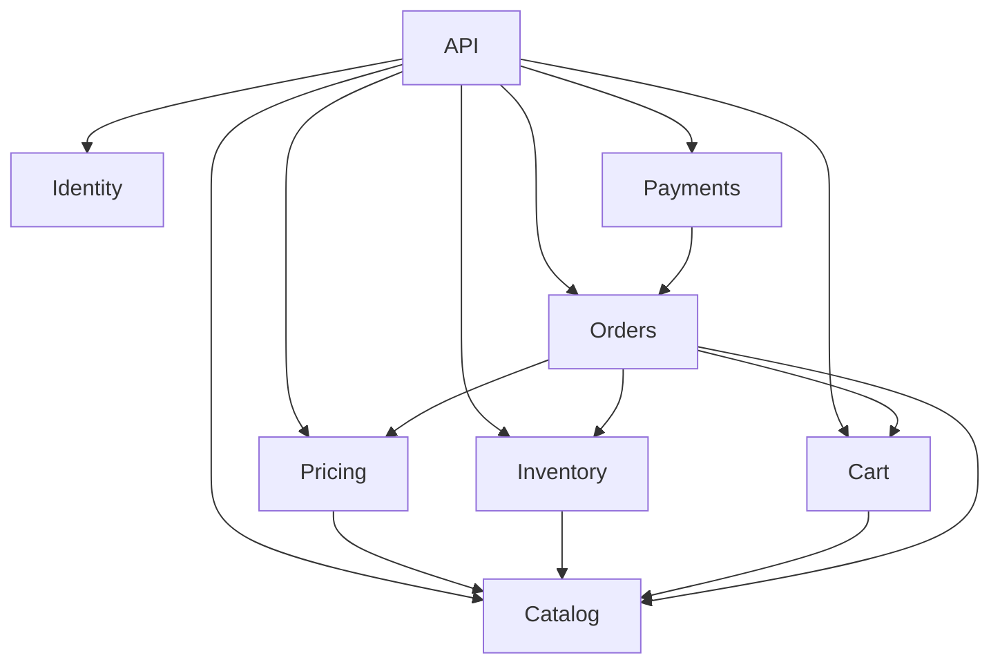

# Architecture and operational boundaries

All seven modules are implemented, as explicitly requested. Each owns a PostgreSQL schema, EF context, migrations and focused persistence port. Domain projects depend only on BuildingBlocks.Domain. Applications depend on their own domain and selected related modules' application contracts. Infrastructure implements its module's ports. The API composes implementations and enforces transport authorization; handlers perform workflow logic and aggregates protect invariants.

| Module | Owned data | Public behavior |
|---|---|---|
| Identity | Users, credentials, roles and lockout | Register, login; operator-only admin bootstrap |
| Catalog | Products and categories | Generic SKU, descriptions, activation and bounded browsing |
| Pricing | Product prices | Set price and authoritative checkout quote |
| Inventory | Stock and order-keyed reservations | Receive, reserve, release, consume |
| Cart | Customer baskets and quantity lines | Replace quantities, read version, clear on checkout |
| Orders | Immutable line/address snapshots and lifecycle | Checkout, own-order reads, cancel, ship, deliver |
| Payments | Manual settlements and full-refund records | Audit actor/time/reference; idempotent recording |

## Dependencies

Arrows between modules mean application interfaces and DTOs, never another module's DbContext, repository or domain entity. No foreign keys or EF navigations cross module schemas. Within-module aggregate dependencies use normal foreign keys. Architecture tests enforce declared reference edges, domain isolation, absence of infrastructure in applications and absence of flower facets.

## Transactions and concurrency

Each command runs on one scoped Npgsql connection in one serializable PostgreSQL transaction. All module contexts enlist in that transaction. Handlers and contract calls are sequential; no parallel use of the connection/DbContexts is permitted. EF SaveChanges across contexts, Identity's internal saves, domain-event effects and the final commit share the transaction. On failure the transaction rolls back and trackers are cleared. Serialization failures, deadlocks, uniqueness conflicts and optimistic-concurrency conflicts return 409. The caller reloads and retries; the server never blindly replays a command containing unknown side effects.

Aggregate roots have revision concurrency tokens and UTC creation/update metadata. Serializable isolation additionally protects aggregate children and read predicates. Reservations are unique by stock/order, carts by customer, product prices by product, checkout keys by customer, and settlements by order/reference. Checkout checks a cart version, obtains authoritative product/price snapshots, enforces one currency, reserves all lines, stores the order and clears the cart together. The idempotency payload hash covers cart version and shipping data. Inventory stock receipts are deliberately not idempotent: an operator must reconcile the result before retrying after an ambiguous network failure.

Domain events remain free of MediatR dependencies. The transaction runner wraps concrete events as typed notifications and dispatches before commit. OrderPaid consumes reservations; OrderCancelled releases them. Handler failure rolls back the whole command. Events are cleared only after commit. There is no durable event stream or external delivery promise: future email/gateway/message-bus integrations must use a transactional outbox with stable event contracts and idempotent consumers. Do not perform external network calls inside transactional domain handlers.

## Security and scope

HTTP customer workflows derive ownership from the JWT subject; callers cannot submit a customer ID. Unknown and unowned order/payment reads both return 404. Administrative mutation endpoints require Admin. Registration never assigns Admin. Operator bootstrap creates a new account only. Password policy, failed-attempt lockout, short token expiry, strict issuer/audience/signature checks and auth endpoint rate limits are enabled. Logs contain request type and timing rather than passwords/tokens. Unknown exceptions return safe ProblemDetails with trace IDs.

This is single-store software. No tenant ID or schema naming convention is a security boundary. Before multi-store deployment, design tenant-aware identity, authorization, unique keys, query scoping, transactions and tests together. Current GUID-only contracts, schema ownership and absence of flower rules reduce coupling without pretending to implement tenancy.

## Deliberate initial limits

Manual settlements/refunds record operator-confirmed off-platform transactions, with actor, reference and timestamps. They never process cards or initiate transfers. Refunds are full and permitted only before shipment; received physical returns require an explicit stock receipt. Pending reservations do not expire automatically; customers must cancel them until an expiry policy and worker are specified. Catalog categories are flat. There is no generic soft-delete infrastructure; products are explicitly deactivated and historical snapshots retained. Account recovery/verification, token revocation, external payments, delivery pricing, taxes, discounts and notifications require separately specified workflows.
